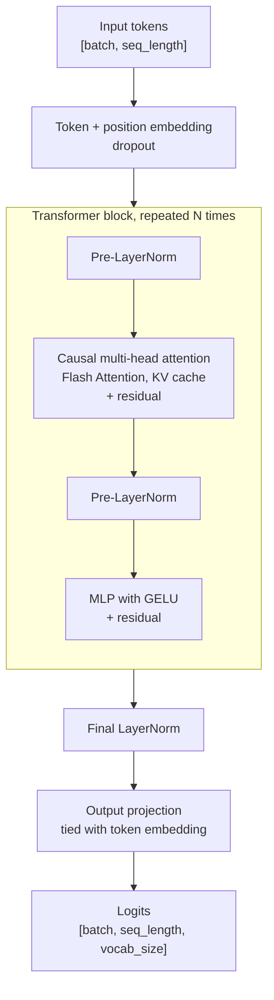
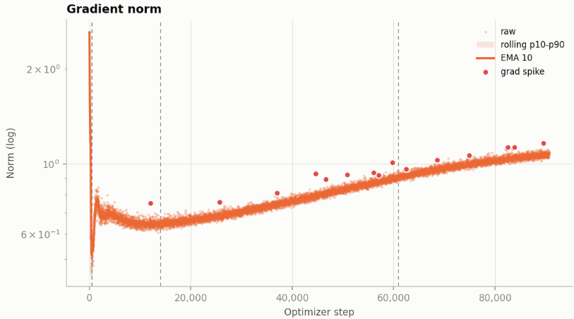
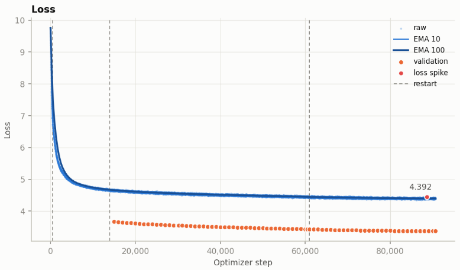
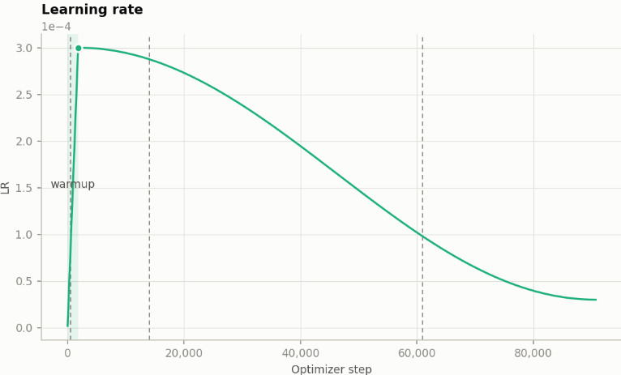
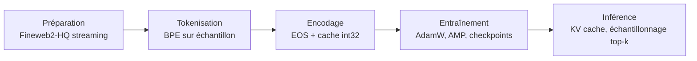
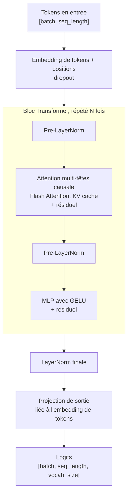

<div align="center">


# Portr-AI

**A French GPT-style language model, built from scratch**

Every component implemented by hand, from raw corpus to text generation.

<br/>


[English](#english) | [Français](#francais)

</div>

---

<a id="english"></a>

## Overview

**Portr-AI** is an autoregressive, GPT-style language model for French, written from scratch in Python and PyTorch. It uses no pretrained weights and no high-level model library.

The goal is educational and technical: implement every building block of a Transformer language model, from BPE tokenization to GPU training and text generation.

- Complete pipeline: data collection, cleaning, tokenization, training, inference
- Custom BPE tokenizer, optimized with a max-heap
- Decoder-only Transformer with Flash Attention and KV cache
- Resumable training with mixed precision and asynchronous checkpoints

The data sources, tokenizer and quality filters are configured for French. The pipeline can be adapted to another language by changing the data sources and the tokenizer settings.


**Contents:** [Pipeline](#pipeline) · [Model architecture](#model-architecture) · [Installation](#installation) · [Usage](#usage) · [Configuration](#configuration) · [Technical optimizations](#technical-optimizations) · [Project structure](#project-structure) · [Roadmap](#roadmap) · [References](#references)

---

## Pipeline


| Stage | What it does | Output |
|---|---|---|
| Data preparation | Streams Fineweb2-HQ, filters lightly, splits by document hash, trains BPE on a sample, and encodes with EOS | `train.jsonl`, `val.jsonl`, `*.bin` |
| Tokenization | BPE model trained only on the tokenizer sample | `bpe_model.json` |
| Training | Next-token prediction on sliding windows | checkpoints, final model |
| Inference | Autoregressive generation with KV cache | generated text |

---

## Model architecture



- Decoder-only GPT with causal self-attention and pre-LayerNorm blocks
- Output head weight-tied to the token embedding
- Flash Attention through `scaled_dot_product_attention`, and a KV cache at decode time
- GPT-2 style scaled initialization

Model sizes are listed in [Configuration](#configuration).

---

## Installation

**Requirements:** Python 3.10+, CUDA (optional but strongly recommended for training), about 6 GB of RAM at minimum and 16 GB or more recommended.

```bash
git clone https://github.com/Por-tra/Portr-AI.git
cd Portr-AI
python -m venv .venv
source .venv/bin/activate        # Linux/macOS
.venv\Scripts\activate           # Windows
pip install -r requirements.txt
```

For GPU training, install PyTorch with the official command matching your CUDA version, for example CUDA 12.1:

```bash
pip install torch torchvision torchaudio --index-url https://download.pytorch.org/whl/cu121
```

The current pipeline reads the Hugging Face datasets. It does not invoke a PDF,
Wikipedia ZIM or legacy web crawler.

---

## Usage

### 1. Data preparation

The complete data pipeline is in `prepare_data.py`. It first checks the available
Fineweb2-HQ split names, then streams the selected split, trains the BPE tokenizer
on a small sample, separates validation documents by a stable hash of `id`, and
encodes each document with `<EOS>` into memory-mappable `int32` files.

```bash
python prepare_data.py --split fr --token-budget 500000000
```

The generated files are `data/datasets/train.jsonl`, `data/datasets/val.jsonl`,
`artifacts/cache/train_tokens.bin`, and `artifacts/cache/val_tokens.bin`.

### 2. Training

```bash
python main.py
```

The manager exposes preparation, training and inference as separate actions:
`1` status, `2` prepare pretraining, `3` resume base training, `4` fresh base,
`5` prepare SFT, `6` resume SFT, `7` base inference, `8` SFT inference,
`9` full base pipeline, `10` fresh SFT in an isolated run directory.

A compatible checkpoint is required to resume. Completed or incompatible runs
are rejected explicitly. New checkpoints record the training contract, tokenizer
fingerprint and CPU/CUDA RNG state. Training gradients and logged loss are weighted
by supervised token counts across accumulated micro-batches. Metrics are CSV files
under `artifacts/`; `tools/analyze_benchmark.py` creates the plots and report.
Train loss includes regularization and mandatory UL; perplexity comes from validation CE.

<p align="center">
  
  
  
</p>

### 3. Inference

Use menu action `7` or `8` for inference. In action `9`, setting
`INFERENCE_ONLY_FROM_FINAL_MODEL = True` skips data preparation and training.
Inference loads trained embeddings without adding random vocabulary rows.
An interactive reprompt mode lets you test independent prompts; it does not retain conversation history:

```
[main] reprompt mode active
prompt> Tell me a story
[reprompt] tokens: 52
[reprompt] text: Tell me a story about an old castle...

prompt> :quit
```

---

## Configuration

All parameters are centralized in `main.py` unless stated otherwise. Warmup is computed at runtime as `WARMUP_RATIO` of the total number of optimizer steps.

**Model**

| Parameter | Default | Description |
|---|---|---|
| `VOCAB_SIZE` | 16 000 | BPE vocabulary size |
| `EMBEDDING_DIM` | 384 | Embedding dimension |
| `NUM_HEADS` | 8 | Attention heads |
| `NUM_BLOCKS` | 4 | Transformer blocks |
| `SEQ_LENGTH` | 256 | Context length |
| `dropout` | 0.1 | Dropout rate |
| Total parameters | about 13.3M | Current tied-embedding configuration |

**Training**

| Parameter | Default | Description |
|---|---|---|
| `BATCH_SIZE_CUDA` / `BATCH_SIZE_CPU` | 32 / 8 | Batch size per micro-step |
| `GRAD_ACCUM_STEPS_CUDA` / `GRAD_ACCUM_STEPS_CPU` | 2 / 4 | Effective batch size: 64 on GPU, 32 on CPU |
| `LEARNING_RATE` | 3e-4 | Peak learning rate (cosine decay) |
| `WEIGHT_DECAY` | 0.1 | AdamW, applied to 2D weights only |
| `EPOCHS` | 3 | Number of epochs |
| `WARMUP_RATIO` | 0.02 | Linear warmup, 2% of optimizer steps |
| `LABEL_SMOOTHING` | 0.1 | Reduces overconfidence |
| `Z_LOSS_WEIGHT` | 1e-4 | Logit stabilization |
| `USE_AMP` | True | Mixed precision (float16 on GPU) |
| `CHECKPOINT_EVERY` | 500 | Asynchronous checkpoint frequency, in steps |
| `RESUME_FROM_CHECKPOINT` | True | Resume from the last checkpoint |

**Mandatory repetition unlikelihood during training**

The training objective adds `alpha * -log(1 - p(negative_token))` for tokens
that would complete a previously seen n-gram in the supervised history. This is
a selective token-level adaptation of [Welleck et al., 2019](https://arxiv.org/abs/1908.04319),
not an inference repetition penalty or sampled sequence-level training.
The correct next token is always excluded from negatives, including valid repeats.
Masked prompts, padding and special tokens reset the history; document and answer
boundaries are therefore respected by the standard pipeline.

In `main.py`, `UNLIKELIHOOD_WEIGHT` for pretraining and
`SFT_UNLIKELIHOOD_WEIGHT` for SFT both default to `0.1`. The penalty is always
enabled: zero, negative, nonnumeric and nonfinite weights are rejected. Its
strength remains adjustable, strictly above zero. `0.1` is a modest initial
experimental coefficient, not a validated optimum on Portr-AI. Shared settings are
`UNLIKELIHOOD_NGRAM_SIZE=4` **BPE tokens**, and `UNLIKELIHOOD_WINDOW=64`
previous completion positions. Direct training API callers use the corresponding
`TrainConfig`/`SFTConfig` fields and must supply special/boundary IDs through
`unlikelihood_exclude_token_ids`; labels use `-100` for ignored positions.

Validation uses pure cross-entropy, without this penalty. New checkpoints record
the settings and reject a resume with a different objective. Legacy checkpoints
without those settings, and checkpoints with zero weight, cannot resume training
silently; their weights can still initialize a new SFT run (menu option 10).
Use separate configured output directories for
a new pretraining run. No actual Portr-AI model has been retrained with this feature.
It adds compute, does not detect semantic filler, and cannot guarantee removal of
repetition or preservation of every legitimate alternative. Compare generations
and validation CE on otherwise matched runs. Details: [pipeline review](docs/REVUE_PIPELINE.md).
Run the feature tests with `python -B -m unittest discover -s training/tests -v`.
Synthetic microbenchmark on an RTX 4060 Laptop, bf16, batch 8: about 15–16% extra
forward/loss/backward time for pretraining and 22–26% for SFT in the tested cases.
These are not full training-run estimates; setup and limitations are in the linked details.

**Inference**

| Parameter | Default | Description |
|---|---|---|
| `INFERENCE_ONLY_FROM_FINAL_MODEL` | False | Skip training and load the final model |
| `INFER_PROMPT` | custom | Starting prompt |
| `INFER_MAX_NEW_TOKENS` | 80 | Maximum generated tokens |
| `INFER_TEMPERATURE` | 0.9 | Sampling temperature |
| `INFER_TOP_K` | 20 | Top-k sampling |

**Data preparation** (command-line options)

| Option | Value | Description |
|---|---|---|
| `--split` | `fr` | Split checked against the configuration's available splits |
| `--token-budget` | 500M | Approximate maximum number of encoded tokens |
| `--tokenizer-sample-bytes` | 300 MiB | Raw sample used to train the BPE |
| `--val-percent` | 1 | Hash bucket percentage reserved for validation |

---

## Technical optimizations

| Area | Technique | Benefit |
|---|---|---|
| BPE tokenizer | Incremental pair counting, max-heap with lazy deletion, word-to-ids cache | Fast training and encoding without the naive O(N x V) pair count |
| Attention | Flash Attention (`sdpa`), KV cache, `is_causal` disabled during decode | 2-4x less VRAM, no recomputation of past tokens |
| Training | Mixed precision with `GradScaler`, gradient accumulation, fused AdamW with decay/no-decay groups, cosine schedule with warmup | Stable training and a large effective batch on limited VRAM |
| I/O | Asynchronous checkpoints in a joined thread, explicit write errors | CPU snapshots plus background disk writes |
| Data | Lightweight filtering, document-hash validation split, EOS-separated streaming encoding, memory-mapped binary cache (`int32`) | Corpus never fully loaded in RAM |

The `is_causal` flag must be `False` during decode (when `past_kv is not None`), otherwise the whole KV cache is masked out and ignored.

---

## Project structure

```
Portr-AI/
├── main.py                  # Pipeline entry point and configuration
├── data/                    # JSONL samples and PyTorch dataset windows
├── tokenizer/               # BPE from scratch and saved model
├── model/                   # Embedding, attention, transformer block, GPT model
├── training/                # Training loop, loss, optimizer
├── inference/               # Text generation with KV cache
├── artifacts/               # Checkpoints, final model, binary token cache
├── asset/                   # README images
└── prepare_data.py          # Fineweb2-HQ streaming, tokenizer, and encoding
```

---

## Roadmap

- [x] BPE tokenizer from scratch (heap-optimized)
- [x] Data pipeline: Hugging Face streaming, cleaning, document splits and EOS
- [ ] Local near-deduplication and semantic contamination audit
- [x] GPT model: embeddings, attention with KV cache, Transformer blocks
- [x] Training loop: mixed precision, gradient accumulation, async checkpoints
- [x] Text generation: top-k, temperature, reprompt mode
- [ ] Evaluation: perplexity curves, BLEU, human evaluation
- [ ] Scaling: larger dataset, medium model of about 50M parameters
- [ ] Advanced optimizations: Flash Attention v2, gradient checkpointing, extended KV cache

---

## References

**Foundational papers**

- [Attention Is All You Need](https://arxiv.org/abs/1706.03762) — Vaswani et al.
- [Language Models are Unsupervised Multitask Learners](https://openai.com/research/better-language-models) — GPT-2 paper
- [The Illustrated Transformer](https://jalammar.github.io/illustrated-transformer/) — Jay Alammar

**BPE tokenization**

- [BPE from Scratch](https://sebastianraschka.com/blog/2025/bpe-from-scratch.html) — Sebastian Raschka
- [BPE explained (video)](https://youtu.be/VrZTHO1E76w)

---

## Author and license

**Lucas** — personal project to learn and implement a French-language LLM from scratch. Released under the MIT License.

<br/>

---

<a id="francais"></a>

<div align="center">

<h1>Version française</h1>

**Un modèle de langage de type GPT en français, construit from scratch**

Chaque composant est implémenté à la main, du corpus brut à la génération de texte.

[English](#english) | [Français](#francais)

</div>

---

## Présentation

**Portr-AI** est un modèle de langage auto-régressif de type GPT pour le français, écrit from scratch en Python et PyTorch. Il n'utilise ni poids pré-entraînés, ni bibliothèque de modèles de haut niveau.

L'objectif est pédagogique et technique : implémenter chaque brique d'un modèle de langage Transformer, de la tokenisation BPE à l'entraînement sur GPU et à la génération de texte.

- Pipeline complet : collecte, nettoyage, tokenisation, entraînement, inférence
- Tokenizer BPE maison, optimisé avec un max-heap
- Transformer decoder-only avec Flash Attention et KV cache
- Entraînement reprenable, en précision mixte, avec checkpoints asynchrones

Les sources de données, le tokenizer et les filtres de qualité sont configurés pour le français. Le pipeline peut être adapté à une autre langue en modifiant les sources de données et les paramètres du tokenizer.


**Sommaire :** [Chaîne de traitement](#chaîne-de-traitement) · [Architecture du modèle](#architecture-du-modèle) · [Prérequis et installation](#prérequis-et-installation) · [Utilisation](#utilisation) · [Paramètres](#paramètres) · [Optimisations techniques](#optimisations-techniques) · [Structure du projet](#structure-du-projet) · [Feuille de route](#feuille-de-route) · [Références](#références)

---

## Chaîne de traitement



| Étape | Rôle | Sortie |
|---|---|---|
| Préparation | Filtre légèrement et sépare train/validation par hash de `id` | `train.jsonl`, `val.jsonl` |
| Tokenisation | Entraîne le modèle BPE sur un échantillon limité | `bpe_model.json` |
| Encodage | Encode en streaming avec `<EOS>` entre les documents | `train_tokens.bin`, `val_tokens.bin` |
| Entraînement | Prédiction du token suivant sur fenêtres glissantes | checkpoints, modèle final |
| Inférence | Génération auto-régressive avec KV cache | texte généré |

---

## Architecture du modèle



- GPT decoder-only avec auto-attention causale et blocs en pre-LayerNorm
- Tête de sortie partageant ses poids avec l'embedding de tokens
- Flash Attention via `scaled_dot_product_attention`, et KV cache au décodage
- Initialisation mise à l'échelle, comme GPT-2

Les tailles du modèle sont indiquées dans [Paramètres](#paramètres).

---

## Prérequis et installation

**Prérequis :** Python 3.10+, CUDA (optionnel mais fortement recommandé pour l'entraînement), environ 6 Go de RAM au minimum et 16 Go ou plus recommandés.

```bash
git clone https://github.com/Por-tra/Portr-AI.git
cd Portr-AI
python -m venv .venv
.venv\Scripts\activate           # Windows
source .venv/bin/activate        # Linux/macOS
pip install -r requirements.txt
```

Pour l'entraînement sur GPU, installer PyTorch avec la commande officielle correspondant à votre version de CUDA, par exemple CUDA 12.1 :

```bash
pip install torch torchvision torchaudio --index-url https://download.pytorch.org/whl/cu121
```

---

## Utilisation

### 1. Préparation des données

`prepare_data.py` vérifie d’abord les splits de `Fineweb2-HQ`, échantillonne le
corpus en streaming, entraîne le BPE sur quelques centaines de Mo, réserve la
validation selon le hash stable de `id`, puis écrit un token `<EOS>` entre les
documents dans les caches `int32`.

```bash
python prepare_data.py --split fr --token-budget 500000000
```

Sorties : `data/datasets/train.jsonl`, `data/datasets/val.jsonl`,
`artifacts/cache/train_tokens.bin` et `artifacts/cache/val_tokens.bin`.

### 2. Entraînement

```bash
python main.py
```

Le manager propose des actions distinctes : `1` état, `2` préparation de la base,
`3` reprise de base, `4` base neuve, `5` préparation SFT, `6` reprise SFT,
`7` inférence de base, `8` inférence SFT, `9` pipeline de base complet,
`10` nouveau SFT depuis la base dans un dossier isolé.

Une reprise exige un checkpoint compatible. Les nouveaux checkpoints conservent
le contrat du run, l'empreinte du tokenizer et les états aléatoires CPU/CUDA.
L'accumulation des gradients et les moyennes de loss sont pondérées par le nombre
de tokens supervisés. Les métriques sont des CSV dans `artifacts/` ;
`tools/analyze_benchmark.py` produit les graphiques et le rapport.
La loss train inclut les régularisations et UL ; la perplexité vient de la CE de validation.

<p align="center">
  
  
  
</p>

### 3. Inférence

Choisir `7` ou `8` pour l'inférence. Avec l'action `9`,
`INFERENCE_ONLY_FROM_FINAL_MODEL = True` évite aussi la préparation des données.
L'inférence conserve le vocabulaire entraîné sans ajouter de lignes aléatoires.
Le mode interactif teste plusieurs prompts indépendants, sans historique de dialogue :

```
[main] reprompt mode active
prompt> Raconte-moi une histoire
[reprompt] tokens: 52
[reprompt] text: Raconte-moi une histoire sur un vieux château...

prompt> :quit
```

---

## Paramètres

Tous les paramètres sont centralisés dans `main.py`, sauf mention contraire. Le warmup est calculé à l'exécution comme `WARMUP_RATIO` du nombre total de pas d'optimisation.

**Modèle**

| Paramètre | Valeur par défaut | Description |
|---|---|---|
| `VOCAB_SIZE` | 16 000 | Taille du vocabulaire BPE |
| `EMBEDDING_DIM` | 384 | Dimension des embeddings |
| `NUM_HEADS` | 8 | Têtes d'attention |
| `NUM_BLOCKS` | 4 | Blocs Transformer |
| `SEQ_LENGTH` | 256 | Longueur du contexte |
| `dropout` | 0.1 | Taux de dropout |
| Paramètres totaux | environ 13,3 M | Configuration actuelle avec poids d'embedding partagés |

**Entraînement**

| Paramètre | Valeur par défaut | Description |
|---|---|---|
| `BATCH_SIZE_CUDA` / `BATCH_SIZE_CPU` | 32 / 8 | Taille de batch par micro-pas |
| `GRAD_ACCUM_STEPS_CUDA` / `GRAD_ACCUM_STEPS_CPU` | 2 / 4 | Batch effectif : 64 sur GPU, 32 sur CPU |
| `LEARNING_RATE` | 3e-4 | Learning rate maximal (décroissance cosinus) |
| `WEIGHT_DECAY` | 0.1 | AdamW, appliqué aux poids 2D uniquement |
| `EPOCHS` | 3 | Nombre d'epochs |
| `WARMUP_RATIO` | 0.02 | Warmup linéaire, 2 % des pas d'optimisation |
| `LABEL_SMOOTHING` | 0.1 | Réduit la sur-confiance |
| `Z_LOSS_WEIGHT` | 1e-4 | Stabilisation des logits |
| `USE_AMP` | True | Précision mixte (float16 sur GPU) |
| `CHECKPOINT_EVERY` | 500 | Fréquence des checkpoints asynchrones, en pas |
| `RESUME_FROM_CHECKPOINT` | True | Reprise depuis le dernier checkpoint |

**Anti-répétition obligatoire pendant l'entraînement : unlikelihood**

L'objectif ajoute `alpha * -log(1 - p(token_negatif))` aux tokens qui termineraient
un n-gramme déjà vu dans le passé supervisé. C'est une adaptation sélective de
l'[unlikelihood de Welleck et al.](https://arxiv.org/abs/1908.04319), appliquée aux
prédictions de tokens pendant l'entraînement. La cible correcte est toujours
retirée des négatifs, même si elle répète une séquence légitime. Prompts masqués,
padding et tokens spéciaux coupent l'historique ; les limites de documents et de
réponses sont respectées par le pipeline standard.

Réglages dans `main.py` :

| Réglage | Défaut | Effet |
|---|---|---|
| `UNLIKELIHOOD_WEIGHT` | `0.1` | Poids alpha strictement positif pour le pré-entraînement |
| `SFT_UNLIKELIHOOD_WEIGHT` | `0.1` | Poids alpha strictement positif pour le SFT, indépendant du précédent |
| `UNLIKELIHOOD_NGRAM_SIZE` | `4` | Taille des n-grammes en **tokens BPE**, minimum 2 |
| `UNLIKELIHOOD_WINDOW` | `64` | Distance maximale des complétions antérieures, au moins la taille du n-gramme |

La pénalité est toujours active en pré-entraînement et SFT. Sa force reste
réglable, mais zéro, les valeurs négatives, non numériques ou non finies sont
refusés. Le coefficient initial `0.1` est volontairement modéré et expérimental,
sans validation sur Portr-AI. Choisir **10** pour un nouveau SFT depuis la base.
Pour un nouveau pré-entraînement, utiliser des répertoires de sortie distincts.
Les API exposent les champs `unlikelihood_*` dans `TrainConfig` et `SFTConfig` ;
les appelants directs doivent fournir les IDs spéciaux/frontières dans
`unlikelihood_exclude_token_ids` et masquer les positions ignorées avec `-100`.

La validation reste en cross-entropy pure : sa perplexité n'inclut pas la pénalité.
Les nouveaux checkpoints enregistrent les réglages et refusent une reprise avec
un objectif différent. Les checkpoints historiques sans ces métadonnées, ou avec
un poids nul, ne peuvent plus reprendre l'entraînement silencieusement. Leurs
poids restent utilisables comme base d'un nouveau SFT ; aucun ancien fichier
n'est migré ou écrasé automatiquement.
Aucun modèle Portr-AI n'a été réentraîné avec cet ajout. Cette méthode ajoute du
calcul, ne reconnaît pas les « mots inutiles » au sens sémantique et ne garantit
pas la disparition des répétitions. Elle ne pénalise pas les répétitions qui
constituent la cible correcte du corpus. Comparer CE et générations sur des runs
comparables reste nécessaire. Voir [la portée et les tests](docs/REVUE_PIPELINE.md).
Tests de cette fonctionnalité : `python -B -m unittest discover -s training/tests -v`.
Sur un microbenchmark synthétique RTX 4060 Laptop, bf16, batch 8, le surcoût
forward/loss/backward mesuré est d'environ 15–16 % en pré-entraînement et
22–26 % en SFT selon les motifs testés. Ce ne sont pas des estimations du temps
d'un run complet ; protocole et limites figurent dans la documentation liée.

**Inférence**

| Paramètre | Valeur par défaut | Description |
|---|---|---|
| `INFERENCE_ONLY_FROM_FINAL_MODEL` | False | Saute l'entraînement et charge le modèle final |
| `INFER_PROMPT` | personnalisé | Prompt de départ |
| `INFER_MAX_NEW_TOKENS` | 80 | Nombre maximal de tokens générés |
| `INFER_TEMPERATURE` | 0.9 | Température d'échantillonnage |
| `INFER_TOP_K` | 20 | Échantillonnage top-k |

**Préparation des données** (options en ligne de commande)

| Option | Valeur | Description |
|---|---|---|
| `--split` | `fr` | Split vérifié parmi ceux disponibles pour la configuration |
| `--token-budget` | 500M | Budget approximatif de tokens encodés |
| `--tokenizer-sample-bytes` | 300 MiB | Échantillon brut utilisé pour entraîner le BPE |
| `--val-percent` | 1 | Pourcentage de buckets hash réservé à la validation |

---

## Optimisations techniques

| Domaine | Technique | Bénéfice |
|---|---|---|
| Tokenizer BPE | Comptage incrémental des paires, max-heap avec suppression paresseuse, cache mot vers ids | Entraînement et encodage rapides, sans le comptage naïf en O(N x V) |
| Attention | Flash Attention (`sdpa`), KV cache, `is_causal` désactivé au décodage | 2 à 4 fois moins de VRAM, aucun recalcul du passé |
| Entraînement | Précision mixte avec `GradScaler`, accumulation de gradients, AdamW fusionné avec groupes decay/no-decay, schedule cosinus avec warmup | Entraînement stable et grand batch effectif malgré une VRAM limitée |
| E/S | Checkpoints asynchrones, attente finale et erreurs remontées | Snapshot CPU et écriture disque en arrière-plan |
| Données | Filtre léger, split validation par hash de document, EOS entre documents, encodage en streaming, cache binaire mémoire-mappé (`int32`) | Corpus jamais chargé entièrement en RAM |

Le flag `is_causal` doit être à `False` au décodage (quand `past_kv is not None`), sinon tout le KV cache est masqué et ignoré.

---

## Structure du projet

```
Portr-AI/
├── main.py                  # Point d'entrée du pipeline et configuration
├── data/                    # JSONL et fenêtres glissantes PyTorch
├── tokenizer/               # BPE from scratch et modèle sauvegardé
├── model/                   # Embedding, attention, bloc Transformer, modèle GPT
├── training/                # Boucle d'entraînement, loss, optimiseur
├── inference/               # Génération de texte avec KV cache
├── artifacts/               # Checkpoints, modèle final, cache binaire de tokens
├── asset/                   # Images du README
└── prepare_data.py          # Fineweb2-HQ, tokenizer et encodage
```

---

## Feuille de route

- [x] Tokenizer BPE from scratch (optimisé avec un heap)
- [x] Pipeline de données : collecte, nettoyage, quasi-dédoublonnage
- [x] Modèle GPT : embeddings, attention avec KV cache, blocs Transformer
- [x] Boucle d'entraînement : précision mixte, accumulation de gradients, checkpoints asynchrones
- [x] Génération de texte : top-k, température, mode reprompt
- [ ] Évaluation : courbes de perplexité, BLEU, évaluation humaine
- [ ] Passage à l'échelle : dataset plus grand, modèle moyen d'environ 50 M de paramètres
- [ ] Optimisations avancées : Flash Attention v2, gradient checkpointing, KV cache étendu

---

## Références

**Articles fondateurs**

- [Attention Is All You Need](https://arxiv.org/abs/1706.03762) — Vaswani et al.
- [Language Models are Unsupervised Multitask Learners](https://openai.com/research/better-language-models) — article GPT-2
- [The Illustrated Transformer](https://jalammar.github.io/illustrated-transformer/) — Jay Alammar

**Tokenisation BPE**

- [BPE from Scratch](https://sebastianraschka.com/blog/2025/bpe-from-scratch.html) — Sebastian Raschka
- [BPE expliqué (vidéo)](https://youtu.be/VrZTHO1E76w)

---

## Auteur et licence

**Lucas** — projet personnel d'apprentissage et d'implémentation from scratch d'un LLM en français. Publié sous licence MIT.

---
Dataset instruction/réponse
> https://huggingface.co/datasets/angeluriot/french_instruct
Angel Uriot : Creator of the project.
---
