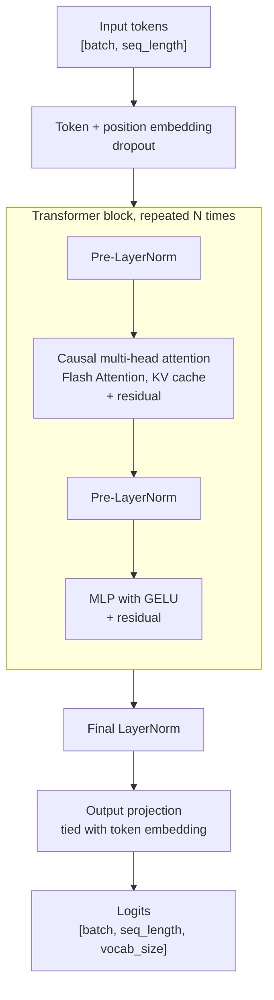
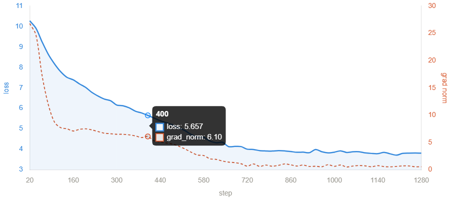
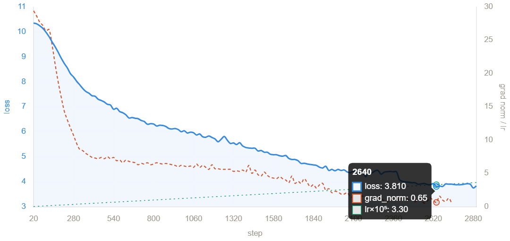
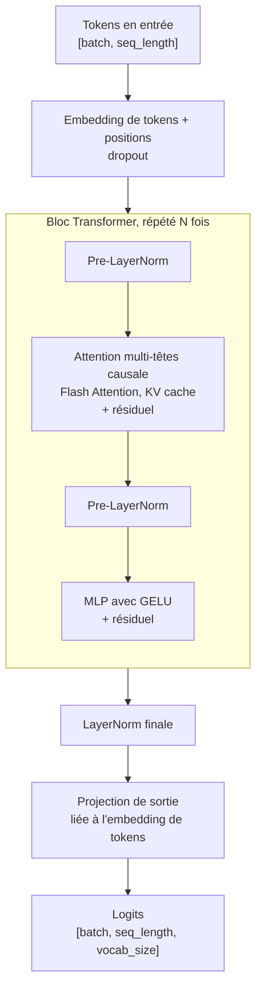

<div align="center">


# Portr-AI

**A French GPT-style language model, built from scratch**

Every component implemented by hand, from raw corpus to text generation.

<br/>


[English](#english) | [Français](#francais)

</div>

---

<a id="english"></a>

## Overview

**Portr-AI** is an autoregressive, GPT-style language model for French, written from scratch in Python and PyTorch. It uses no pretrained weights and no high-level model library.

The goal is educational and technical: implement every building block of a Transformer language model, from BPE tokenization to GPU training and text generation.

- Complete pipeline: data collection, cleaning, tokenization, training, inference
- Custom BPE tokenizer, optimized with a max-heap
- Decoder-only Transformer with Flash Attention and KV cache
- Resumable training with mixed precision and asynchronous checkpoints

The data sources, tokenizer and quality filters are configured for French. The pipeline can be adapted to another language by changing the data sources and the tokenizer settings.

> [!NOTE]
> **Project status.** The pipeline is complete and functional, but it has not been run on the full dataset because of hardware constraints (GPU VRAM, training time). Compute is the only bottleneck.

**Contents:** [Pipeline](#pipeline) · [Model architecture](#model-architecture) · [Installation](#installation) · [Usage](#usage) · [Configuration](#configuration) · [Technical optimizations](#technical-optimizations) · [Project structure](#project-structure) · [Roadmap](#roadmap) · [References](#references)

---

## Pipeline


| Stage | What it does | Output |
|---|---|---|
| Collection | Gathers raw text into a SQLite database | `crawler.db` |
| Cleaning | Sentence-aware chunking and near-duplicate removal | `dataset.jsonl` |
| Tokenization | Trains the BPE model and encodes the corpus into a binary cache | `bpe_model.json` |
| Training | Next-token prediction on sliding windows | checkpoints, final model |
| Inference | Autoregressive generation with KV cache | generated text |

---

## Model architecture



- Decoder-only GPT with causal self-attention and pre-LayerNorm blocks
- Output head weight-tied to the token embedding
- Flash Attention through `scaled_dot_product_attention`, and a KV cache at decode time
- GPT-2 style scaled initialization

Model sizes are listed in [Configuration](#configuration).

---

## Installation

**Requirements:** Python 3.10+, CUDA (optional but strongly recommended for training), about 6 GB of RAM at minimum and 16 GB or more recommended.

```bash
git clone https://github.com/Por-tra/Portr-AI.git
cd Portr-AI
python -m venv .venv
source .venv/bin/activate        # Linux/macOS
.venv\Scripts\activate           # Windows
pip install -r requirements.txt
```

For GPU training, install PyTorch with the official command matching your CUDA version, for example CUDA 12.1:

```bash
pip install torch torchvision torchaudio --index-url https://download.pytorch.org/whl/cu121
```

Optional PDF and Wikipedia ZIM support:

```bash
pip install pdfminer.six libzim
```

---

## Usage

### 1. Data collection

Raw text comes from an async web crawler (`crawl.py`) and from local files (`ingest_local.py`: PDF, TXT, Markdown, Wikipedia ZIM).

```bash
python crawl.py --url https://example.com
python ingest_local.py --dir ./my_documents -r
python ingest_local.py --files wikipedia_fr.zim     # full French Wikipedia (Kiwix), can take several hours
```

### 2. Cleaning and preprocessing

```bash
python clean_db.py --stats          # database statistics
python clean_db.py --all            # full cleanup and export
python build_clean_dataset.py       # build the clean training dataset
```

Chunking is sentence-aware (no mid-sentence cuts) and near-duplicates are detected with Jaccard 8-gram fingerprinting. Thresholds are listed in [Configuration](#configuration).

### 3. Training

```bash
python main.py
```

The interactive pipeline asks for:

- the tokenizer mode: `auto`, `use_existing` or `retrain`
- the encoding cache mode: `auto`, `use_precomputed` or `recompute`

Training resumes automatically from the last checkpoint when `RESUME_FROM_CHECKPOINT = True`. Curves (loss, perplexity, learning rate) are saved in `artifacts/` and can be viewed with TensorBoard.

<p align="center">
  
  
</p>

### 4. Inference

Inference runs at the end of `main.py`, or on its own from the saved model by setting `INFERENCE_ONLY_FROM_FINAL_MODEL = True`. An interactive reprompt mode then lets you test several prompts without restarting the pipeline:

```
[main] reprompt mode active
prompt> Tell me a story
[reprompt] tokens: 52
[reprompt] text: Tell me a story about an old castle...

prompt> :quit
```

---

## Configuration

All parameters are centralized in `main.py` unless stated otherwise. Warmup is computed at runtime as `WARMUP_RATIO` of the total number of optimizer steps.

**Model**

| Parameter | Default | Description |
|---|---|---|
| `VOCAB_SIZE` | 16 000 | BPE vocabulary size |
| `EMBEDDING_DIM` | 384 | Embedding dimension |
| `NUM_HEADS` | 8 | Attention heads |
| `NUM_BLOCKS` | 4 | Transformer blocks |
| `SEQ_LENGTH` | 256 | Context length |
| `dropout` | 0.1 | Dropout rate |
| Total parameters | about 18.7M | `small` configuration |

**Training**

| Parameter | Default | Description |
|---|---|---|
| `BATCH_SIZE_CUDA` / `BATCH_SIZE_CPU` | 32 / 8 | Batch size per micro-step |
| `GRAD_ACCUM_STEPS_CUDA` / `GRAD_ACCUM_STEPS_CPU` | 2 / 4 | Effective batch size: 64 on GPU, 32 on CPU |
| `LEARNING_RATE` | 3e-4 | Peak learning rate (cosine decay) |
| `WEIGHT_DECAY` | 0.1 | AdamW, applied to 2D weights only |
| `EPOCHS` | 3 | Number of epochs |
| `WARMUP_RATIO` | 0.02 | Linear warmup, 2% of optimizer steps |
| `LABEL_SMOOTHING` | 0.1 | Reduces overconfidence |
| `Z_LOSS_WEIGHT` | 1e-4 | Logit stabilization |
| `USE_AMP` | True | Mixed precision (float16 on GPU) |
| `CHECKPOINT_EVERY` | 500 | Asynchronous checkpoint frequency, in steps |
| `RESUME_FROM_CHECKPOINT` | True | Resume from the last checkpoint |

**Inference**

| Parameter | Default | Description |
|---|---|---|
| `INFERENCE_ONLY_FROM_FINAL_MODEL` | False | Skip training and load the final model |
| `INFER_PROMPT` | custom | Starting prompt |
| `INFER_MAX_NEW_TOKENS` | 80 | Maximum generated tokens |
| `INFER_TEMPERATURE` | 0.9 | Sampling temperature |
| `INFER_TOP_K` | 20 | Top-k sampling |

**Data** (command-line options)

| Option | Value | Description |
|---|---|---|
| `--chunk-size` | 700 | Chunk size, in words |
| `--chunk-overlap` | 0 | Overlap between chunks |
| `--min-chars` | 180 | Minimum chunk length, in characters |
| `--near-dup-threshold` | 0.8 | Jaccard similarity threshold for near-duplicates |
| `--remove-short` | 100 | Remove pages under 100 words (`clean_db.py`) |
| `--commit-every` / `--progress-every` | 200 / 250 | Commit and progress frequency for large ZIM ingestion |

---

## Technical optimizations

| Area | Technique | Benefit |
|---|---|---|
| BPE tokenizer | Incremental pair counting, max-heap with lazy deletion, word-to-ids cache | Fast training and encoding without the naive O(N x V) pair count |
| Attention | Flash Attention (`sdpa`), KV cache, `is_causal` disabled during decode | 2-4x less VRAM, no recomputation of past tokens |
| Training | Mixed precision with `GradScaler`, gradient accumulation, fused AdamW with decay/no-decay groups, cosine schedule with warmup | Stable training and a large effective batch on limited VRAM |
| I/O | Asynchronous checkpoints in a daemon thread, deferred `loss.item()` | No blocking on disk writes or GPU-CPU sync |
| Data | Sentence-aware chunking, Jaccard near-dedup, streaming encoding, memory-mapped binary cache (`int32`) | Corpus never fully loaded in RAM |

The `is_causal` flag must be `False` during decode (when `past_kv is not None`), otherwise the whole KV cache is masked out and ignored.

---

## Project structure

```
Portr-AI/
├── main.py                  # Pipeline entry point and configuration
├── data/                    # Dataset (sliding windows), SQLite storage, clean corpus
├── tokenizer/               # BPE from scratch and saved model
├── model/                   # Embedding, attention, transformer block, GPT model
├── training/                # Training loop, loss, optimizer
├── inference/               # Text generation with KV cache
├── artifacts/               # Checkpoints, final model, binary token cache
├── asset/                   # README images
├── ingest_local.py          # Local file ingestion
├── build_clean_dataset.py   # Clean dataset builder
└── clean_db.py              # Database audit and cleanup
```

---

## Roadmap

- [x] BPE tokenizer from scratch (heap-optimized)
- [x] Data pipeline: collection, cleaning, near-deduplication
- [x] GPT model: embeddings, attention with KV cache, Transformer blocks
- [x] Training loop: mixed precision, gradient accumulation, async checkpoints
- [x] Text generation: top-k, temperature, reprompt mode
- [ ] Evaluation: perplexity curves, BLEU, human evaluation
- [ ] Scaling: larger dataset, medium model of about 50M parameters
- [ ] Advanced optimizations: Flash Attention v2, gradient checkpointing, extended KV cache

---

## References

**Foundational papers**

- [Attention Is All You Need](https://arxiv.org/abs/1706.03762) — Vaswani et al.
- [Language Models are Unsupervised Multitask Learners](https://openai.com/research/better-language-models) — GPT-2 paper
- [The Illustrated Transformer](https://jalammar.github.io/illustrated-transformer/) — Jay Alammar

**BPE tokenization**

- [BPE from Scratch](https://sebastianraschka.com/blog/2025/bpe-from-scratch.html) — Sebastian Raschka
- [BPE explained (video)](https://youtu.be/VrZTHO1E76w)

---

## Author and license

**Lucas** — personal project to learn and implement a French-language LLM from scratch. Released under the MIT License.

<br/>

---

<a id="francais"></a>

<div align="center">

<h1>Version française</h1>

**Un modèle de langage de type GPT en français, construit from scratch**

Chaque composant est implémenté à la main, du corpus brut à la génération de texte.

[English](#english) | [Français](#francais)

</div>

---

## Présentation

**Portr-AI** est un modèle de langage auto-régressif de type GPT pour le français, écrit from scratch en Python et PyTorch. Il n'utilise ni poids pré-entraînés, ni bibliothèque de modèles de haut niveau.

L'objectif est pédagogique et technique : implémenter chaque brique d'un modèle de langage Transformer, de la tokenisation BPE à l'entraînement sur GPU et à la génération de texte.

- Pipeline complet : collecte, nettoyage, tokenisation, entraînement, inférence
- Tokenizer BPE maison, optimisé avec un max-heap
- Transformer decoder-only avec Flash Attention et KV cache
- Entraînement reprenable, en précision mixte, avec checkpoints asynchrones

Les sources de données, le tokenizer et les filtres de qualité sont configurés pour le français. Le pipeline peut être adapté à une autre langue en modifiant les sources de données et les paramètres du tokenizer.

> [!NOTE]
> **État du projet.** Le pipeline est complet et fonctionnel, mais il n'a pas pu être exécuté sur le dataset complet à cause de contraintes matérielles (VRAM GPU, temps d'entraînement). Le calcul est le seul facteur limitant.

**Sommaire :** [Chaîne de traitement](#chaîne-de-traitement) · [Architecture du modèle](#architecture-du-modèle) · [Prérequis et installation](#prérequis-et-installation) · [Utilisation](#utilisation) · [Paramètres](#paramètres) · [Optimisations techniques](#optimisations-techniques) · [Structure du projet](#structure-du-projet) · [Feuille de route](#feuille-de-route) · [Références](#références)

---

## Chaîne de traitement


| Étape | Rôle | Sortie |
|---|---|---|
| Collecte | Rassemble le texte brut dans une base SQLite | `crawler.db` |
| Nettoyage | Découpage par phrases et suppression des quasi-doublons | `dataset.jsonl` |
| Tokenisation | Entraîne le modèle BPE et encode le corpus dans un cache binaire | `bpe_model.json` |
| Entraînement | Prédiction du token suivant sur fenêtres glissantes | checkpoints, modèle final |
| Inférence | Génération auto-régressive avec KV cache | texte généré |

---

## Architecture du modèle



- GPT decoder-only avec auto-attention causale et blocs en pre-LayerNorm
- Tête de sortie partageant ses poids avec l'embedding de tokens
- Flash Attention via `scaled_dot_product_attention`, et KV cache au décodage
- Initialisation mise à l'échelle, comme GPT-2

Les tailles du modèle sont indiquées dans [Paramètres](#paramètres).

---

## Prérequis et installation

**Prérequis :** Python 3.10+, CUDA (optionnel mais fortement recommandé pour l'entraînement), environ 6 Go de RAM au minimum et 16 Go ou plus recommandés.

```bash
git clone https://github.com/Por-tra/Portr-AI.git
cd Portr-AI
python -m venv .venv
.venv\Scripts\activate           # Windows
source .venv/bin/activate        # Linux/macOS
pip install -r requirements.txt
```

Pour l'entraînement sur GPU, installer PyTorch avec la commande officielle correspondant à votre version de CUDA, par exemple CUDA 12.1 :

```bash
pip install torch torchvision torchaudio --index-url https://download.pytorch.org/whl/cu121
```

Support optionnel des PDF et des ZIM Wikipedia :

```bash
pip install pdfminer.six libzim
```

---

## Utilisation

### 1. Collecte de données

Le texte brut provient d'un crawler web asynchrone (`crawl.py`) et de fichiers locaux (`ingest_local.py` : PDF, TXT, Markdown, ZIM Wikipedia).

```bash
python crawl.py --url https://example.com
python ingest_local.py --dir ./mes_documents -r
python ingest_local.py --files wikipedia_fr.zim     # Wikipedia FR complète (Kiwix), plusieurs heures possibles
```

### 2. Nettoyage et prétraitement

```bash
python clean_db.py --stats          # statistiques de la base
python clean_db.py --all            # nettoyage complet et export
python build_clean_dataset.py       # construction du dataset propre
```

Le découpage respecte les phrases (aucune coupure en milieu de phrase) et les quasi-doublons sont détectés par empreintes de 8-grammes (similarité de Jaccard). Les seuils sont indiqués dans [Paramètres](#paramètres).

### 3. Entraînement

```bash
python main.py
```

Le pipeline interactif demande :

- le mode du tokenizer : `auto`, `use_existing` ou `retrain`
- le mode du cache d'encodage : `auto`, `use_precomputed` ou `recompute`

L'entraînement reprend automatiquement depuis le dernier checkpoint si `RESUME_FROM_CHECKPOINT = True`. Les courbes (loss, perplexité, learning rate) sont sauvegardées dans `artifacts/` et visualisables avec TensorBoard.

<p align="center">
  
  
</p>

### 4. Inférence

L'inférence s'exécute à la fin de `main.py`, ou seule à partir du modèle sauvegardé en réglant `INFERENCE_ONLY_FROM_FINAL_MODEL = True`. Un mode interactif permet ensuite de tester plusieurs prompts sans relancer le pipeline :

```
[main] reprompt mode active
prompt> Raconte-moi une histoire
[reprompt] tokens: 52
[reprompt] text: Raconte-moi une histoire sur un vieux château...

prompt> :quit
```

---

## Paramètres

Tous les paramètres sont centralisés dans `main.py`, sauf mention contraire. Le warmup est calculé à l'exécution comme `WARMUP_RATIO` du nombre total de pas d'optimisation.

**Modèle**

| Paramètre | Valeur par défaut | Description |
|---|---|---|
| `VOCAB_SIZE` | 16 000 | Taille du vocabulaire BPE |
| `EMBEDDING_DIM` | 384 | Dimension des embeddings |
| `NUM_HEADS` | 8 | Têtes d'attention |
| `NUM_BLOCKS` | 4 | Blocs Transformer |
| `SEQ_LENGTH` | 256 | Longueur du contexte |
| `dropout` | 0.1 | Taux de dropout |
| Paramètres totaux | environ 18,7 M | Configuration `small` |

**Entraînement**

| Paramètre | Valeur par défaut | Description |
|---|---|---|
| `BATCH_SIZE_CUDA` / `BATCH_SIZE_CPU` | 32 / 8 | Taille de batch par micro-pas |
| `GRAD_ACCUM_STEPS_CUDA` / `GRAD_ACCUM_STEPS_CPU` | 2 / 4 | Batch effectif : 64 sur GPU, 32 sur CPU |
| `LEARNING_RATE` | 3e-4 | Learning rate maximal (décroissance cosinus) |
| `WEIGHT_DECAY` | 0.1 | AdamW, appliqué aux poids 2D uniquement |
| `EPOCHS` | 3 | Nombre d'epochs |
| `WARMUP_RATIO` | 0.02 | Warmup linéaire, 2 % des pas d'optimisation |
| `LABEL_SMOOTHING` | 0.1 | Réduit la sur-confiance |
| `Z_LOSS_WEIGHT` | 1e-4 | Stabilisation des logits |
| `USE_AMP` | True | Précision mixte (float16 sur GPU) |
| `CHECKPOINT_EVERY` | 500 | Fréquence des checkpoints asynchrones, en pas |
| `RESUME_FROM_CHECKPOINT` | True | Reprise depuis le dernier checkpoint |

**Inférence**

| Paramètre | Valeur par défaut | Description |
|---|---|---|
| `INFERENCE_ONLY_FROM_FINAL_MODEL` | False | Saute l'entraînement et charge le modèle final |
| `INFER_PROMPT` | personnalisé | Prompt de départ |
| `INFER_MAX_NEW_TOKENS` | 80 | Nombre maximal de tokens générés |
| `INFER_TEMPERATURE` | 0.9 | Température d'échantillonnage |
| `INFER_TOP_K` | 20 | Échantillonnage top-k |

**Données** (options en ligne de commande)

| Option | Valeur | Description |
|---|---|---|
| `--chunk-size` | 700 | Taille des chunks, en mots |
| `--chunk-overlap` | 0 | Chevauchement entre chunks |
| `--min-chars` | 180 | Longueur minimale d'un chunk, en caractères |
| `--near-dup-threshold` | 0.8 | Seuil de similarité de Jaccard pour les quasi-doublons |
| `--remove-short` | 100 | Supprime les pages de moins de 100 mots (`clean_db.py`) |
| `--commit-every` / `--progress-every` | 200 / 250 | Fréquence de commit et d'affichage pour les gros ZIM |

---

## Optimisations techniques

| Domaine | Technique | Bénéfice |
|---|---|---|
| Tokenizer BPE | Comptage incrémental des paires, max-heap avec suppression paresseuse, cache mot vers ids | Entraînement et encodage rapides, sans le comptage naïf en O(N x V) |
| Attention | Flash Attention (`sdpa`), KV cache, `is_causal` désactivé au décodage | 2 à 4 fois moins de VRAM, aucun recalcul du passé |
| Entraînement | Précision mixte avec `GradScaler`, accumulation de gradients, AdamW fusionné avec groupes decay/no-decay, schedule cosinus avec warmup | Entraînement stable et grand batch effectif malgré une VRAM limitée |
| E/S | Checkpoints asynchrones dans un thread daemon, `loss.item()` différé | Pas de blocage sur les écritures disque ni de synchronisation GPU-CPU |
| Données | Découpage par phrases, quasi-dédoublonnage Jaccard, encodage en streaming, cache binaire mémoire-mappé (`int32`) | Corpus jamais chargé entièrement en RAM |

Le flag `is_causal` doit être à `False` au décodage (quand `past_kv is not None`), sinon tout le KV cache est masqué et ignoré.

---

## Structure du projet

```
Portr-AI/
├── main.py                  # Point d'entrée du pipeline et configuration
├── data/                    # Dataset (fenêtres glissantes), stockage SQLite, corpus propre
├── tokenizer/               # BPE from scratch et modèle sauvegardé
├── model/                   # Embedding, attention, bloc Transformer, modèle GPT
├── training/                # Boucle d'entraînement, loss, optimiseur
├── inference/               # Génération de texte avec KV cache
├── artifacts/               # Checkpoints, modèle final, cache binaire de tokens
├── asset/                   # Images du README
├── ingest_local.py          # Ingestion de fichiers locaux
├── build_clean_dataset.py   # Construction du dataset propre
└── clean_db.py              # Audit et nettoyage de la base
```

---

## Feuille de route

- [x] Tokenizer BPE from scratch (optimisé avec un heap)
- [x] Pipeline de données : collecte, nettoyage, quasi-dédoublonnage
- [x] Modèle GPT : embeddings, attention avec KV cache, blocs Transformer
- [x] Boucle d'entraînement : précision mixte, accumulation de gradients, checkpoints asynchrones
- [x] Génération de texte : top-k, température, mode reprompt
- [ ] Évaluation : courbes de perplexité, BLEU, évaluation humaine
- [ ] Passage à l'échelle : dataset plus grand, modèle moyen d'environ 50 M de paramètres
- [ ] Optimisations avancées : Flash Attention v2, gradient checkpointing, KV cache étendu

---

## Références

**Articles fondateurs**

- [Attention Is All You Need](https://arxiv.org/abs/1706.03762) — Vaswani et al.
- [Language Models are Unsupervised Multitask Learners](https://openai.com/research/better-language-models) — article GPT-2
- [The Illustrated Transformer](https://jalammar.github.io/illustrated-transformer/) — Jay Alammar

**Tokenisation BPE**

- [BPE from Scratch](https://sebastianraschka.com/blog/2025/bpe-from-scratch.html) — Sebastian Raschka
- [BPE expliqué (vidéo)](https://youtu.be/VrZTHO1E76w)

---

## Auteur et licence

**Lucas** — projet personnel d'apprentissage et d'implémentation from scratch d'un LLM en français. Publié sous licence MIT.